  

  

  
  
  
  

---

### 👋 Sobre mim

Sou desenvolvedor full stack com **mais de seis anos** criando aplicações web, APIs e automações: de sistemas embarcados na **WEG** a plataformas SaaS na **Digitaly Tech**, passando por saúde digital na **OncoAI** e por projetos de pesquisa e ensino na **Universidade de São Paulo**.

- 🛠️ No dia a dia: **Python, TypeScript, Django, NestJS, React, Next.js, PostgreSQL e Docker**
- 🚀 Hoje construo produtos SaaS próprios e para clientes pela **CodeSmart**, do banco de dados ao deploy
- 🎓 Bacharel em Ciência da Computação pela **USP São Carlos** (ICMC), com artigo publicado sobre ensino de programação
- 💡 Gosto de entender o problema antes de escrever a primeira linha: a melhor solução é a que faz sentido para o negócio e para quem usa

### 🧰 Tecnologias

  <a href="https://skillicons.dev">
    
     
    
  </a>

### 🚀 Produtos em produção

| Produto | O que faz | Stack |
|---|---|---|
| **[Pediaq](https://pediaq.com.br)** | SaaS para restaurantes sem comissão por pedido: cardápio, delivery, mesas com QR Code, PDV e painel em tempo real | Next.js · NestJS · Prisma · Redis · BullMQ |
| **[Lembra-me](https://lembrame.online)** | Assistente pessoal para Android, iOS e Web: lembretes, contas, empréstimos, metas e agenda | React Native · Expo · NestJS · PostgreSQL (RLS) |
| **[CodeMeet](https://meet.fabiodias.blog)** | Videoconferência com vídeo, áudio, compartilhamento de tela e chat | WebRTC · Socket.IO · Next.js · NestJS |
| **[Meu Financeiro](https://financeiro.fabiodias.blog)** | Finanças pessoais para iPhone e Web, com Face ID e backups cifrados | React Native · Expo · NestJS · PostgreSQL |
| **[Codesmart CRM](https://crm.fabiodias.blog)** | CRM comercial com prospecção, análise de sites por IA, Kanban, propostas e WhatsApp | Next.js · NestJS · Prisma · IA generativa |
| **[rifaplay](https://rifaplay.com.br)** | SaaS multi-tenant de campanhas online com Pix em vários gateways e afiliados | Django · PostgreSQL · Redis · Docker |
| **[Roomy](https://roomyapp.shop)** | Marketplace de quartos e apartamentos para alugar, com busca por mapa e chat | Next.js · Prisma · MapLibre |
| **[Lumé](https://lumeagenda.com.br)** | Agenda, fidelidade e sinal via Pix para salões de beleza | Next.js · Prisma · PostgreSQL |

Mais projetos e detalhes no <a href="https://fabiodias.blog">portfólio</a>.

### 💼 Experiência

| Período | Cargo | Empresa |
|---|---|---|
| 2025 a 2026 | Middle Full Stack Developer | Digitaly Tech |
| 2024 a 2025 | Junior Full Stack Developer | OncoAI |
| 2023 a 2024 | Junior Full Stack Developer | UNIMAIS |
| 2022 a 2023 | Intern RPA Developer | Smarthis |
| 2021 a 2022 | Junior Software Developer | HopInCode |
| 2020 a 2021 | Intern Full Stack Developer | WEG |

### 📈 Atividade

  

  <picture>
    <source media="(prefers-color-scheme: dark)" srcset="./assets/pacman-dark.svg">
    <source media="(prefers-color-scheme: light)" srcset="./assets/pacman.svg">
    
  </picture>

Boa parte do meu trabalho fica em repositórios privados de clientes, então o gráfico mostra só uma parte do dia a dia.

